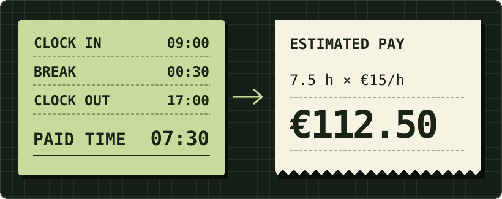

# WorkCount

**the shift is over. so is the math.**

WorkCount is the Android timer I wanted for keeping a record of hours worked and estimating what they add up to. Start it when you clock in. Pause it for the break. Check the total when you clock out.



*Example shift. 09:00–17:00 with a 30-minute break makes 7.5 paid hours. At €15/hour, that's €112.50.*

## Work a shift

1. Set your default hourly rate on first launch. Save workplaces if the rate changes depending on where you work.
2. Tap **Start** on **Home**. Pause for a break, resume when you get back, and tap **Stop** when you're done.
3. Open **Journal** to check or edit the shift. Filter by date, place, or status. In **Settings**, export that filtered view as CSV or PDF.

If you forget to stop the timer, WorkCount can remind you or auto-stop it. There's also a home-screen widget and an optional biometric or PIN lock.

## Get it on a phone

Use Android Studio, Android SDK 36, and JDK 21 for the Gradle daemon. The Android modules target Java 17. The app runs on Android 8.0 or later.

```bash
git clone https://github.com/Yunykk/workcount.git
cd workcount
bash ./gradlew assembleDebug
```

On Windows, run `.\gradlew.bat assembleDebug` from the checkout. You can also open the checkout in Android Studio and run the `app` configuration on a device or emulator.

To install on a connected device with USB debugging and Android platform tools on your PATH:

```bash
adb install -r app/build/outputs/apk/debug/app-debug.apk
```

Run tests with `bash ./gradlew test` or `.\gradlew.bat test` on Windows.

## Keep a copy

WorkCount stores shifts on the device. Location access is optional and can fill the place on an active shift. Earnings are estimates, and there's no account or automatic sync. Make a JSON backup in **Settings** before clearing app data or changing phones.

Kotlin · Jetpack Compose · Room · DataStore

[Contributing](CONTRIBUTING.md) · [MIT license](LICENSE)
